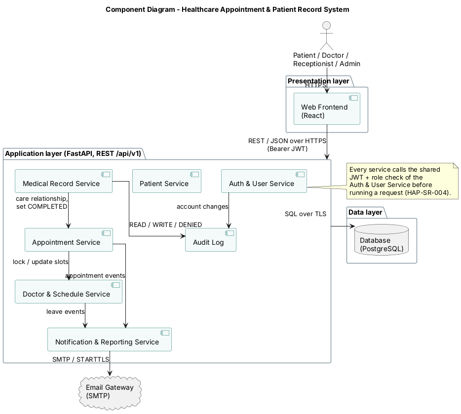
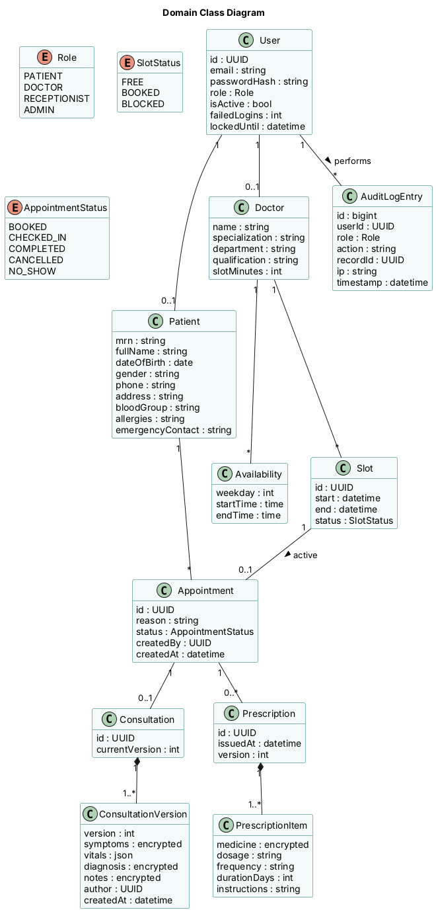

### 3.3 Component (UML) Diagram

#### Component diagram

The system is split into three layers. The **Web Frontend** is the only part users touch; it calls the application layer through one REST API (`/api/v1`) over HTTPS with a bearer JWT. The **application layer** contains seven components. The Appointment Service locks and updates slots owned by the Doctor & Schedule Service and publishes appointment events to the Notification & Reporting Service. The Medical Record Service asks the Appointment Service whether a care relationship exists and marks appointments COMPLETED, and writes every access to the Audit Log. All components store data in one **PostgreSQL** database. The only external system is the **Email Gateway (SMTP)**.

#### Domain class diagram

The class diagram shows the main persistent entities. A `User` has one role and is linked to at most one `Patient` or `Doctor` profile. A `Doctor` has weekly `Availability` rules, from which `Slot`s are generated. A `Slot` can hold **at most one active** `Appointment` — this multiplicity is the conflict rule of HAP-F-032. An `Appointment` may have one `Consultation`, stored as one or more immutable `ConsultationVersion`s (HAP-F-044), and any number of `Prescription`s with their `PrescriptionItem`s. Fields marked `encrypted` are encrypted at rest (HAP-SR-006). Every action is recorded as an `AuditLogEntry` (HAP-SR-007).
