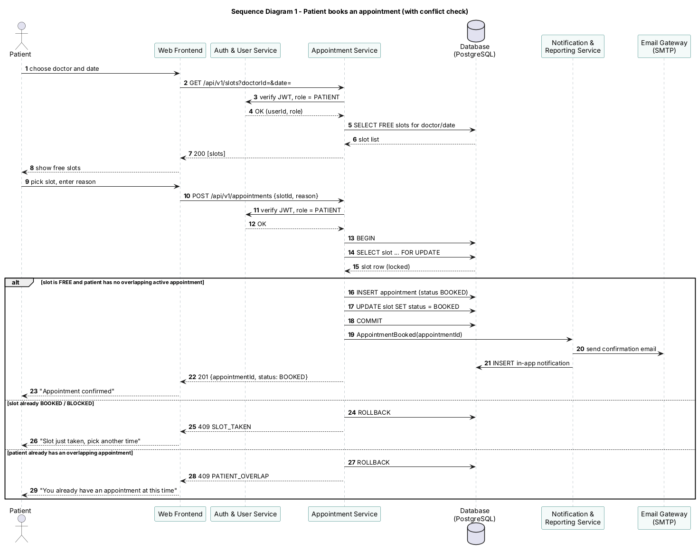

### 4.2 UML Sequence Diagrams

#### Sequence diagram 1 – Patient books an appointment (with conflict check)

**Walk-through**

1. The patient chooses a doctor and date. The Web Frontend calls `GET /api/v1/slots?doctorId=&date=`.
2. The Appointment Service asks the Auth & User Service to verify the JWT and the PATIENT role (HAP-SR-004).
3. The Appointment Service reads the FREE slots for that doctor and date and returns them (HAP-F-030, target ≤ 1 s, HAP-NF-002).
4. The patient picks a slot and enters a reason. The frontend sends `POST /api/v1/appointments {slotId, reason}`.
5. After the token check, the Appointment Service opens a transaction and locks the slot row with `SELECT … FOR UPDATE`. Any other booking request for the same slot now waits.
6. **Main path:** the slot is FREE and the patient has no overlapping active appointment. The service inserts the appointment with status BOOKED, marks the slot BOOKED and commits (HAP-F-031, HAP-F-032).
7. The service publishes an `AppointmentBooked` event. The Notification & Reporting Service sends a confirmation email through the SMTP gateway and stores an in-app notification (HAP-F-050).
8. The frontend receives `201` and shows "Appointment confirmed".
9. **Alternative – slot taken:** if the locked slot is no longer FREE (another request committed first, or the doctor is on leave), the transaction is rolled back and `409 SLOT_TAKEN` is returned. The frontend asks the patient to pick another time.
10. **Alternative – patient overlap:** if the patient already has an active appointment at an overlapping time, the transaction is rolled back and `409 PATIENT_OVERLAP` is returned.

Because the lock and the checks happen inside one transaction, and the partial unique index rejects any second active appointment for a slot, two patients can never hold the same slot.
