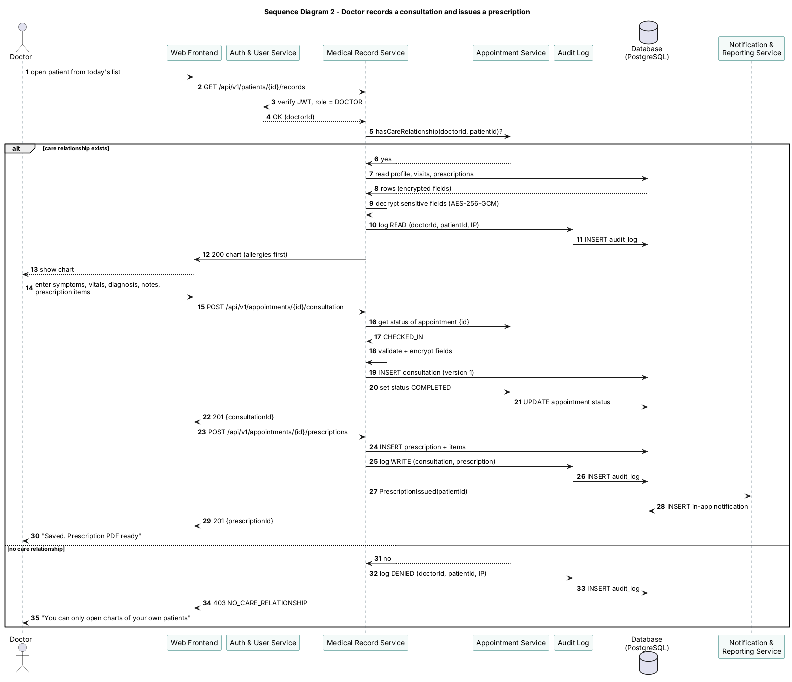

#### Sequence diagram 2 – Doctor records a consultation and issues a prescription

**Walk-through**

1. The doctor opens a patient from today's appointment list. The Web Frontend calls `GET /api/v1/patients/{id}/records`.
2. The Medical Record Service verifies the JWT and the DOCTOR role through the Auth & User Service.
3. It asks the Appointment Service whether this doctor has a care relationship with the patient, i.e. whether the patient has or had an appointment with this doctor (HAP-F-040, HAP-SR-004).
4. **Main path:** the relationship exists. The service reads the chart, decrypts the encrypted fields (HAP-SR-006), writes a READ entry to the Audit Log (HAP-SR-007) and returns the chart with allergies first.
5. The doctor enters symptoms, vitals, diagnosis and notes. `POST /appointments/{id}/consultation` checks that the appointment is CHECKED_IN, encrypts the sensitive fields, saves version 1 of the consultation and asks the Appointment Service to set the status to COMPLETED (HAP-F-041).
6. The doctor adds the prescription items. `POST /appointments/{id}/prescriptions` stores the prescription and its items (HAP-F-042).
7. Both writes are recorded as WRITE entries in the Audit Log. The Notification & Reporting Service creates an in-app message telling the patient a prescription is ready (the message never contains the medicine names).
8. The doctor sees "Saved. Prescription PDF ready".
9. **Alternative – no care relationship:** the service writes a DENIED entry to the Audit Log and returns `403 NO_CARE_RELATIONSHIP`; no patient data leaves the server.
