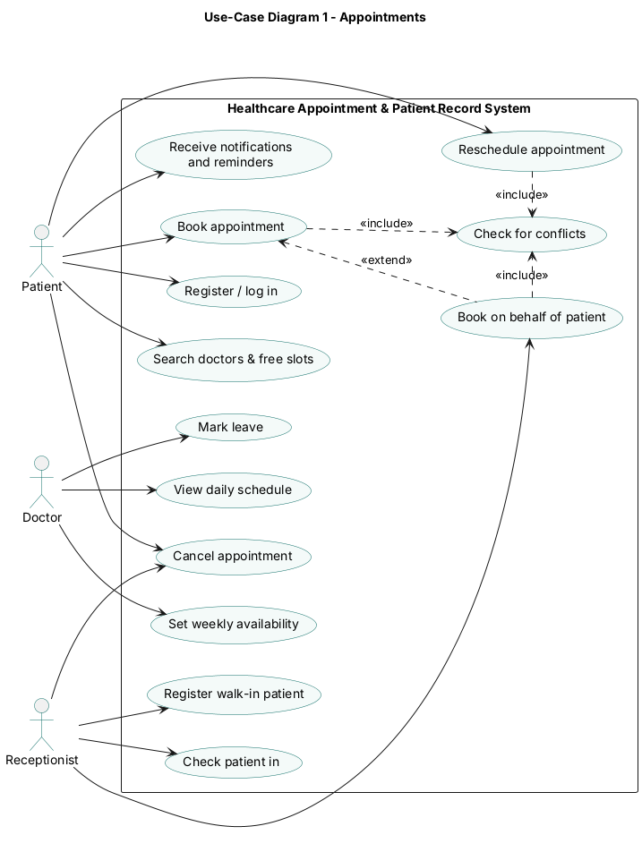
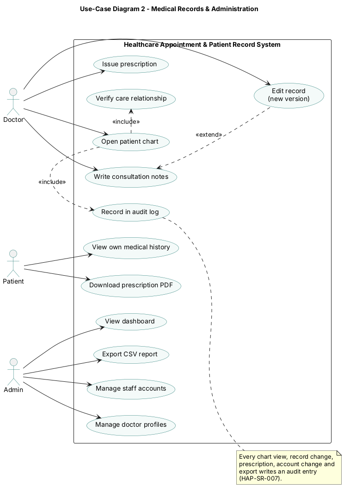

## 7. System models and diagrams

### 7.1 UML Use-Case diagrams

The system has four actors: **Patient**, **Doctor**, **Receptionist** and **Admin**. The use cases are split across two diagrams so each stays readable.

#### Diagram 1 – Appointments

Patients register, search for doctors and free slots, and book, reschedule or cancel appointments (HAP-F-001, HAP-F-030–033); they receive notifications and reminders (HAP-F-050). The Receptionist registers walk-in patients (HAP-F-011), books on a patient's behalf (HAP-F-035) and checks patients in (HAP-F-034). Booking, rescheduling and booking on behalf of a patient all *include* "Check for conflicts", which enforces HAP-F-032. Doctors set weekly availability and leave (HAP-F-021, HAP-F-022) and view their daily schedule (HAP-F-040).

#### Diagram 2 – Medical Records & Administration

Doctors open a patient chart, write consultation notes and issue prescriptions (HAP-F-040–042). Opening a chart *includes* "Verify care relationship" (HAP-SR-004) and "Record in audit log" (HAP-SR-007). Editing a record *extends* writing notes and always creates a new version (HAP-F-044). Patients view their own history and download prescription PDFs (HAP-F-043). The Admin manages staff accounts and doctor profiles, views the dashboard and exports CSV reports (HAP-F-003, HAP-F-020, HAP-F-051, HAP-F-052).
